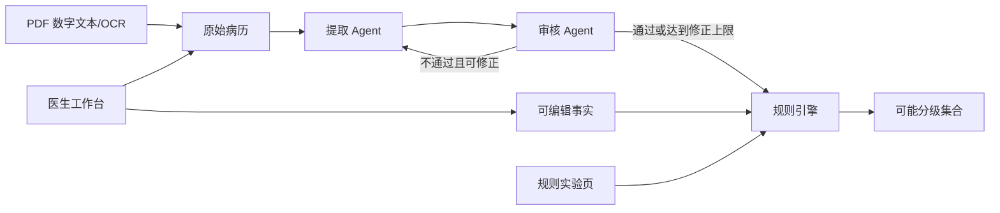

# 系统架构

| 属性 | 值 |
|---|---|
| 文档状态 | 当前实现 |
| 适用规则版本 | `2.2.0` |
| 系统类型 | LLM 事实提取与审核 + 确定性规则引擎 |
| 主要入口 | `medi grade`、`medi web`（`src/medi/cli.py`） |

## 1. 目标与设计原则

系统将已确诊目标疾病的病历转换为结构化事实，并由确定性规则引擎返回所有与已知事实一致的可能分级。

架构遵循以下原则：

- **事实提取与规则判断分离**：LLM 只提取和审核事实，不计算等级；
- **规则结果可复现**：相同结构化输入必须产生相同输出；
- **原始缺失与规则默认值分离**：LLM 不得补猜，缺失事实仍为 `value=null, mentioned=false, evidence=null`；规则引擎按字段注册表应用已配置的默认值，未配置时保留所有可达状态；
- **组件可替换**：工作流通过 `Extractor`、`Reviewer` 接口注入模型实现；
- **边界处校验**：进入规则计算前，由规则引擎执行严格运行时 Schema 校验；
- **分级公开输出最小化**：`medi.grading.classify`、命令行及既有规则 API 只返回状态、可能等级和 R；本地医生工作台另有按需查询的路径解释接口。

## 2. 系统上下文



系统存在三条调用路径：

1. **完整病历工作流**：原始病历 → 提取 → 审核/修正 → 规则引擎；
2. **医生修订事实**：工作台展示事实与证据 → 医生修改 → 规则引擎重新计算，不再调用 LLM；
3. **规则引擎直连**：实验页或代码直接提交完整事实 JSON → 规则引擎。

第三条路径用于规则调试，不执行病历提取或事实审核。

## 3. 组件与职责

| 组件 | 代码位置 | 输入 | 输出 | 职责 |
|---|---|---|---|---|
| 提取 Agent 接口 | `src/medi/workflow/agents.py` | 病历、上一版事实、审核意见 | 完整事实表 | 定义可替换的提取协议 |
| 审核 Agent 接口 | `src/medi/workflow/agents.py` | 病历、事实表、修正次数 | 审核结论 | 定义可替换的审核协议 |
| DeepSeek 适配器 | `src/medi/workflow/deepseek/` | Agent 请求 | JSON 对象 | 分别组织提示词、调用模型、校验审核输出 |
| LangGraph 编排 | `src/medi/workflow/graph.py` | 病历、Extractor、Reviewer | 工作流最终输出 | 控制提取、审核、重试与规则调用 |
| 工作流状态 | `src/medi/workflow/state.py` | 节点增量状态 | `WorkflowState` | 约束节点共享字段和公开结果类型 |
| 字段注册表 | `src/medi/grading/field_registry.py` | 字段定义 | 字段契约 | 集中维护原始事实类型、单位、默认值、提示词和共享提取规则 |
| 事实模型与输入解析器 | `src/medi/grading/models.py`、`src/medi/grading/parser.py` | JSON 字符串 | `ExtractedFacts` | 严格校验事实结构和字段类型，并核对注册表字段集合 |
| PESI 求值器 | `src/medi/grading/pesi.py` | `ExtractedFacts` | PESI 与 C-R 联合状态 | 计算加权评分边界并保持共享字段一致 |
| 可能性求值器 | `src/medi/grading/possibilities.py` | `ExtractedFacts` | 可能分级集合 | 执行现行规则、缺失状态压缩和结果排序 |
| 判断树与路径解释 | `src/medi/grading/decision_tree.py` | 同轮规则求值得到的路径 | 完整树、可达路径及确定性 | 校验路径确实抵达相应叶子；按前序判断下的出口数标记确定/可能 |
| 规则公开入口 | `src/medi/grading/engine.py` | JSON 字符串 | `{"results": [...]}` | 串联解析与分类 |
| 本地医生工作台 | `src/medi/web/server.py`、`static/doctor.html`、`static/rule_tree.js` | 病历文本或 PDF | 事实、审核状态、可能分级及可达路径树 | FastAPI 接入工作流；展示可编辑事实、完整规则树并支持无需 LLM 的重分级 |
| PDF 提取适配器 | `src/medi/web/pdf_text.py` | PDF 字节 | 病历文本 | 按页提取数字文本，空白页使用本机 OCR |
| 规则实验页 | `src/medi/web/static/index.html` | 人工填写的事实 | 可能分级集合 | 构造事实 JSON、直接调用规则 API |
| 命令行入口 | `src/medi/cli.py` | UTF-8 病历文件或标准输入 | 工作流 JSON | 加载当前目录配置并运行完整病历工作流 |

## 4. 完整工作流

### 4.1 正常路径

```text
读取病历
  → extraction：生成包含全部字段的事实表
  → review：对照病历审核事实表
  → engine：校验事实表并计算所有可能等级
  → 返回 completed
```

首次提取不计入修正次数。审核不通过时，工作流把上一版完整事实表和审核问题一并交回提取 Agent。最多允许三次修正，因此提取和审核最多各执行四次。

### 4.2 达到修正上限

当前实现中，第四次审核即使仍未通过，也会把最新事实表提交给规则引擎：

- Schema 合法：返回 `status="completed"` 和规则结果；
- Schema 非法：返回 `status="error"` 和错误信息。

因此，`status="completed"` 表示规则引擎成功执行，不等价于最终审核结论为通过。命令行原有输出契约不变；医生工作台通过 `analyze_medical_record` 的新增返回值展示审核结论及事实。

LangGraph 节点、状态字段、路由条件和重试语义见《工作流编排规范》。

## 5. 数据边界

### 5.1 原始病历边界

原始病历只进入提取 Agent 和审核 Agent。规则引擎不得读取原始病历或根据文本重新推导事实。

### 5.2 结构化事实边界

结构化事实是 LLM 层与规则层之间唯一的数据接口：

- 字段集合固定；
- 每个字段必须具有 `value`、`mentioned`、`evidence`；
- 提取与证据要求见《结构化事实提取规范》；
- 类型、阈值和分类语义见《规则引擎规范》；
- `field_registry.py` 集中定义字段元数据与提取说明；`models.py` 校验实际输入，`parser.py` 核对字段集合并转换错误信息。

### 5.3 结果边界

规则引擎返回去重且稳定排序的可能结果：

```json
{
  "results": [
    {"grade": "C1", "has_r": false},
    {"grade": "B1", "has_r": false}
  ]
}
```

完整工作流在外层增加状态：

```json
{
  "status": "completed",
  "results": [
    {"grade": "B1", "has_r": false}
  ]
}
```

上述既有输出契约不变。工作台另用 `GET /api/decision-tree` 取得完整规则树，并用 `POST /api/decision-trace` 提交完整结构化事实，得到相同的 `results` 和去重后的 `paths`。每条路径包含最终等级、R 及按顺序经过的判断出口；页面不从等级倒推路径，也不读取原始病历来推断条件。

路径标记“确定”表示在相同前序判断下、按当前事实及字段默认值仅有一个可达出口；若仍有多个出口则标记“可能”。这是条件于前序路径的程序语义，不表示病历未记载的事实已经得到医学证实。筛选单条路径时仍以完整可达路径集合计算该标记。

## 6. 错误处理

| 位置 | 当前行为 |
|---|---|
| 病历为空或文件不可读 | 命令行入口返回错误 JSON，退出码为 1 |
| API Key 缺失或明显无效 | DeepSeek 客户端初始化失败 |
| 模型返回空内容或非法 JSON | 抛出 `ValueError`；命令行入口统一转为错误 JSON |
| 审核结果结构非法 | 抛出 `ValueError` |
| 事实表 Schema 非法 | 工作流返回 `status="error"`；网页 API 返回 HTTP 400 |
| 未预期异常 | 命令行入口返回错误 JSON，退出码为 1 |

规则引擎只捕获输入相关的 `TypeError` 和 `ValueError`。编程错误或基础设施错误不得伪装为规则输入错误。

## 7. 依赖与配置

| 依赖 | 用途 |
|---|---|
| Python `>=3.10` | 运行环境 |
| LangGraph `>=1.0,<2.0` | 工作流编排 |
| OpenAI Python SDK `>=2.0,<3.0` | 调用 DeepSeek 的 OpenAI 兼容接口 |
| Pydantic `>=2.0,<3.0` | 定义和校验结构化事实模型 |
| python-dotenv `>=1.0,<2.0` | 加载本地环境变量 |
| FastAPI、Uvicorn、python-multipart | 本地 HTTP 服务及 PDF 上传 |
| PyMuPDF；本机 Tesseract 中文/英文语言包 | PDF 文本层提取与扫描页 OCR |

运行时配置：

| 环境变量 | 必需 | 默认值 | 用途 |
|---|---|---|---|
| `DEEPSEEK_API_KEY` | 是 | 无 | DeepSeek API 认证 |
| `DEEPSEEK_MODEL` | 否 | `deepseek-v4-flash` | 模型名称 |

API Key 只能从环境变量读取，不得写入病历、提示词、日志或代码仓库。

## 8. 状态、持久化与安全边界

当前实现：

- 不配置 LangGraph checkpointer；工作流状态只存在于单次进程调用中；
- 不把病历、事实表或结果写入数据库；
- 本地网页不保存病历；浏览器当前页面内临时保留文本与事实以供修订；
- DeepSeek 调用会把病历发送到外部模型服务；
- 代码未实现病历脱敏、访问控制、审计日志或数据留存策略。

因此当前项目适合开发和规则验证，不应在缺少隐私、安全与合规设计的情况下直接处理真实敏感病历。

## 9. 文档事实来源

| 主题 | 唯一事实来源 |
|---|---|
| 等级公式、阈值、缺失值与结果排序 | `docs/规则引擎规范.md` |
| 字段类型、单位、缺失默认值与实际提取提示词 | `src/medi/grading/field_registry.py`；`docs/字段策略.md` 供人工审核，不作为运行配置 |
| 提取、证据、单位与审核要求 | `docs/结构化事实提取规范.md` |
| 系统组件和边界 | 本文档 |
| LangGraph 节点、状态、路由与重试 | `docs/工作流编排规范.md` |
| 运行时 JSON 校验 | `src/medi/grading/models.py` 与 `src/medi/grading/parser.py` |

文档与代码冲突时，应先停止发布，确认预期语义后同时修正文档、代码和测试；不得默认以任一方覆盖另一方。

## 10. 已知限制

- 提取与审核均依赖同一模型供应商，错误可能相关；
- 审核达到上限后仍会继续规则计算，公开结果不标识审核是否通过；
- 审核输出只做结构校验，不校验 `field` 是否属于固定字段；
- 既有规则公开接口不返回假设或路径；工作台专用接口仅给出判断分支的可达性，不提供逐字段证据归因；
- 工作流没有持久化、恢复、超时、退避重试或人工复核节点；
- Web API 仅用于本地测试，没有认证或生产级安全控制；PDF 限制 10 MB、50 页，病历文本接口尚无独立大小限制；
- 判断树的高亮是与结构化事实相容的可能路径；缺失且无默认值时可同时高亮互斥出口，不能当作唯一已证实病程。
