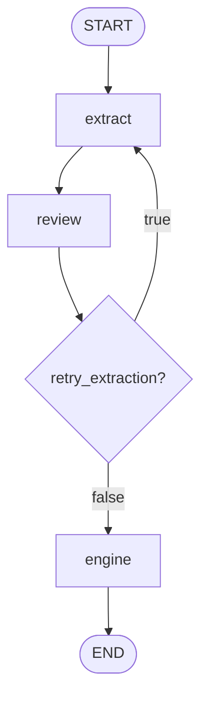

# LangGraph 工作流编排规范

| 属性 | 值 |
|---|---|
| 文档状态 | 当前实现 |
| 适用规则版本 | `2.2.0` |
| 工作流入口 | `grade_medical_record`、`build_grading_graph` |
| 状态类型 | `WorkflowState` |
| 最大修正次数 | 3 |
| 持久化 | 无 |

## 1. 目的与边界

本规范定义病历分级工作流的节点、状态、路由、修正计数、终止条件和异常语义。

工作流负责协调提取 Agent、审核 Agent 与规则引擎，但不定义：

- 字段的医学含义和提取要求，见《结构化事实提取规范》；
- 等级阈值、优先级和缺失值规则，见《规则引擎规范》；
- 系统外部边界、依赖和安全限制，见 [ARCHITECTURE.md](ARCHITECTURE.md)；
- LangGraph 的通用概念和学习示例，见[LangGraph 学习笔记](参考资料/LangGraph学习笔记.md)；该笔记不是产品规范。

## 2. 编排目标

工作流必须满足：

- 首次提取后必须经过审核；
- 审核不通过时，在修正额度内把上一版事实和审核意见交回提取 Agent；
- 审核通过或达到修正上限后，必须把最新事实表提交给规则引擎；
- 规则引擎成功时返回 `completed`，输入校验失败时返回 `error`；
- 节点之间通过 `WorkflowState` 交换数据，不依赖模块级可变状态。

## 3. 依赖注入接口

工作流不直接依赖 DeepSeek。`build_grading_graph` 接受两个可调用对象：

```python
class Extractor(Protocol):
    def __call__(self, request: ExtractionRequest) -> dict[str, Any]: ...

class Reviewer(Protocol):
    def __call__(self, request: ReviewRequest) -> ReviewResult: ...
```

因此生产适配器、测试替身或其他模型供应商可以复用同一张图。

### 3.1 `ExtractionRequest`

| 字段 | 首次提取 | 修正提取 | 含义 |
|---|---:|---:|---|
| `medical_record` | 必须 | 必须 | 原始病历全文 |
| `revision_count` | 必须，值为 0 | 必须，值为 1–3 | 已进入的修正轮次 |
| `previous_facts` | 不提供 | 必须 | 上一版完整事实表 |
| `review_feedback` | 不提供 | 必须 | 上一轮审核结论和问题 |

Extractor 每次都必须返回一份新的完整事实表。工作流使用新结果整体覆盖 `extracted_facts`，不执行字段级合并。

### 3.2 `ReviewRequest`

| 字段 | 含义 |
|---|---|
| `medical_record` | 原始病历全文 |
| `extracted_facts` | 当前完整事实表 |
| `revision_count` | 当前修正次数 |

Reviewer 必须返回：

```json
{
  "approved": false,
  "issues": [
    {
      "field": "age_years",
      "issue_type": "incorrect_value",
      "reason": "病历记录63岁，当前值为36",
      "suggestion": "重新核对年龄原文"
    }
  ]
}
```

审核结构的详细约束见《结构化事实提取规范》第 8 节。

## 4. 图结构



固定边和条件边：

| 起点 | 条件 | 终点 |
|---|---|---|
| `START` | 无 | `extract` |
| `extract` | 无 | `review` |
| `review` | `retry_extraction=true` | `extract` |
| `review` | `retry_extraction=false` | `engine` |
| `engine` | 无 | `END` |

除上述路径外，不得添加绕过审核直接进入规则引擎的路径。

## 5. 节点契约

### 5.1 `extract`

输入：

- `medical_record`；
- 首次提取之外，还包括 `extracted_facts` 和 `review_result`；
- `revision_count`，缺省按 0 读取。

处理：

1. 创建 `ExtractionRequest`；
2. 调用注入的 Extractor；
3. 用返回的完整事实表覆盖状态中的 `extracted_facts`。

输出状态增量：

```python
{"extracted_facts": extractor(request)}
```

本节点不校验事实表 Schema。运行时严格校验发生在 `engine` 节点调用规则引擎时。

### 5.2 `review`

输入：`medical_record`、`extracted_facts`、`revision_count`。

处理：

1. 调用 Reviewer；
2. 读取当前 `revision_count`，缺省为 0；
3. 计算是否允许修正；
4. 仅在确实返回 `extract` 时把计数加 1。

路由公式：

```text
retry_extraction =
    review.approved = false
    AND revision_count < MAX_REVISIONS
```

计数公式：

```text
next_revision_count =
    revision_count + 1    if retry_extraction = true
    revision_count        otherwise
```

输出状态增量：

```python
{
    "review_result": review,
    "revision_count": next_revision_count,
    "retry_extraction": retry_extraction,
}
```

### 5.3 条件路由

`route_after_review` 只能返回：

- `extract`：`retry_extraction=true`；
- `engine`：`retry_extraction=false`。

路由函数不修改状态。

### 5.4 `engine`

输入：最新的 `extracted_facts`。

处理：

1. 将事实表序列化为 JSON 字符串；
2. 调用规则引擎公开入口 `classify`；
3. 成功时写入 `engine_result` 和 `final_output`；
4. 捕获输入相关的 `TypeError`、`ValueError`，写入 `engine_error` 和错误输出。

成功状态增量：

```json
{
  "engine_result": {
    "results": [{"grade": "C1", "has_r": false}]
  },
  "engine_error": null,
  "final_output": {
    "status": "completed",
    "results": [{"grade": "C1", "has_r": false}]
  }
}
```

失败状态增量：

```json
{
  "engine_error": "缺少输入变量: age_years",
  "final_output": {
    "status": "error",
    "error": "缺少输入变量: age_years"
  }
}
```

`engine` 不读取 `review_result.approved`。只要路由进入本节点，就会尝试计算最新事实表。

## 6. 状态契约

`WorkflowState` 使用 `TypedDict(total=False)`。字段可以由不同节点逐步写入，没有声明 Reducer，因此重复字段采用 LangGraph 默认覆盖行为。

| 字段 | 类型 | 首次写入方 | 后续写入 | 含义 |
|---|---|---|---|---|
| `medical_record` | `str` | 调用方 | 不修改 | 原始病历 |
| `revision_count` | `int` | 调用方，初始为 0 | `review` | 已进入的修正轮次 |
| `extracted_facts` | `dict` | `extract` | 每次 `extract` 整体覆盖 | 当前完整事实表 |
| `review_result` | `ReviewResult` | `review` | 每次 `review` 覆盖 | 当前审核结论 |
| `retry_extraction` | `bool` | `review` | 每次 `review` 覆盖 | 条件路由标志 |
| `engine_result` | `ClassificationResult` | `engine` | 不重复写入 | 规则引擎成功结果 |
| `engine_error` | `str \| None` | `engine` | 不重复写入 | 规则引擎输入错误 |
| `final_output` | `CompletedOutput \| ErrorOutput` | `engine` | 不重复写入 | 工作流公开结果 |

调用编译图时，初始状态必须至少包含：

```python
{
    "medical_record": medical_record,
    "revision_count": 0,
}
```

## 7. 修正计数语义

`MAX_REVISIONS = 3` 表示审核不通过后最多允许三次修正，不包含首次提取。

| 阶段 | 进入 `extract` 时的 `revision_count` | 含义 |
|---|---:|---|
| 首次提取 | 0 | 不属于修正 |
| 第一次修正 | 1 | 第一次审核不通过 |
| 第二次修正 | 2 | 第二次审核不通过 |
| 第三次修正 | 3 | 第三次审核不通过 |

第三次修正后会进行第四次审核：

- 审核通过：进入 `engine`；
- 审核不通过：由于 `revision_count < 3` 为假，仍进入 `engine`；
- 最终 `revision_count` 保持为 3。

因此单次工作流最多调用 Extractor 四次、Reviewer 四次。

## 8. 终止和输出语义

### 8.1 成功终止

```json
{
  "status": "completed",
  "results": [
    {"grade": "C1", "has_r": false}
  ]
}
```

`completed` 只表示规则引擎成功解析并计算最新事实表，不保证最终审核为 `approved=true`。

### 8.2 规则输入错误

```json
{
  "status": "error",
  "error": "缺少输入变量: age_years"
}
```

`error` 表示规则引擎拒绝事实表。当前公开输出不提供审核结论、修正次数或节点轨迹。

## 9. 异常传播

| 异常位置 | 是否在图内捕获 | 当前结果 |
|---|---:|---|
| Extractor 抛出异常 | 否 | 图调用失败，异常传播给调用方 |
| Reviewer 抛出异常 | 否 | 图调用失败，异常传播给调用方 |
| 条件路由错误 | 否 | 图调用失败，异常传播给调用方 |
| `classify` 抛出 `TypeError`、`ValueError` | 是 | 转换为 `status="error"` |
| `classify` 其他异常 | 否 | 图调用失败，异常传播给调用方 |

`medi grade` 在图外捕获所有异常，打印错误 JSON 并返回退出码 1。直接调用 `grade_medical_record` 的代码必须自行处理未捕获异常。

## 10. 持久化与执行特性

当前编译图未配置 checkpointer、store 或中断点，因此：

- 状态只存在于单次 `invoke` 调用中；
- 进程退出后不能恢复；
- 不支持人工审核后继续执行；
- 不支持跨进程幂等恢复；
- 每次调用都会重新执行完整流程；
- 同一病历因 LLM 非确定性可能得到不同事实表，尽管当前模型参数设置为 `temperature=0`。

工作流节点按当前图结构串行执行。规则引擎自身不依赖 LangGraph。

## 11. 验收条件

| 编号 | 场景 | 期望行为 |
|---:|---|---|
| W1 | 首次提取后审核通过 | Extractor、Reviewer 各调用一次，随后进入 engine |
| W2 | 连续四次审核不通过 | 首次提取 + 三次修正；Extractor、Reviewer 各调用四次 |
| W3 | 第一次审核不通过，第二次通过 | 第二次 ExtractionRequest 包含上一版事实、审核意见和 `revision_count=1` |
| W4 | 达到修正上限仍未通过 | 使用最新事实表进入 engine，计数保持 3 |
| W5 | Extractor 返回不完整事实表 | engine 返回 `status="error"` |
| W6 | 规则引擎返回多个可能结果 | 工作流原样放入 `final_output.results` |
| W7 | 自定义 Extractor、Reviewer 满足 Protocol | 无需依赖 DeepSeek 即可运行图 |
| W8 | Extractor 或 Reviewer 抛出异常 | 异常向调用方传播，不伪装成规则输入错误 |

对应自动化测试位于 `tests/test_workflow.py`。DeepSeek JSON 调用与审核结构测试位于 `tests/test_deepseek.py`。

## 12. 已知限制与演进方向

当前限制：

- 达到修正上限后仍继续分级，最终输出不标识审核未通过；
- 没有节点级超时、重试、退避或熔断；
- 没有持久化、恢复和人工介入；
- 没有记录每轮事实差异或完整执行轨迹；
- 图内没有统一的 Agent 异常输出；
- 工作流公开结果不包含规则版本和模型信息。

若引入人工复核、持久化执行或生产级错误恢复，必须先更新本规范，再修改状态 Schema、图结构和测试。
