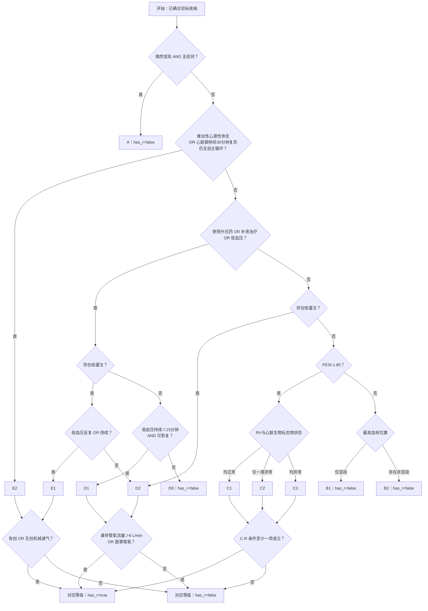

# 2.2.0 需求与验收（归档）

| 属性 | 内容 |
|---|---|
| 状态 | 已归档；现行行为以[规则引擎规范](../规则引擎规范.md)为准 |
| 目标规则版本 | `2.2.0` |
| 基线 | 编写时的基线版本为 2.1.0 |
| 范围 | 新主等级分流、低血压与低灌注定义、字段政策、验收病例 |
| 用途 | 记录下一版的目标；不得据此描述当前程序输出 |

本文件保留实施前的讨论记录和验收草案；其中“待确认”与“尚未实现”等措辞反映当时状态，不代表当前代码。现行规则以[规则引擎规范](../规则引擎规范.md)为准。

## 1. 已确认的业务决定

1. A 仍为互斥门控：偶然发现且无症状时输出 A，不进入其他主等级。
2. E2：难治性心源性休克，**或**心脏骤停经 30 分钟复苏仍未恢复自主循环。
3. E2 未命中后，以“使用升压药 **或** 补液治疗 **或** 低血压”作为第一分流条件。升压药、补液是否针对本次低血压，不加额外限制。
4. 低血压条件为 `SBP < 90 mmHg OR 收缩压下降幅度 > 40 mmHg`；等于阈值不命中。
5. 低灌注条件为以下四项的 OR：`乳酸 > 2 mmol/L`、精神状态改变、`MAP < 60 mmHg`、急性肾功能不全。现行 D2 中的尿量和心脏指数不再计入这一低灌注判断。
6. 第一分流条件为真且存在低灌注：低血压“反复 **或** 持续”时为 E1，否则为 D2。
7. 第一分流条件为真且不存在低灌注：低血压持续时间 **<15 分钟**且可恢复时为 D1，否则为 D0。D0 固定 `has_r=false`。
8. 第一分流条件为假：有低灌注时为 D2，否则进入 PESI。`PESI >= 85` 进入 C；`PESI < 85` 进入 B。恰好 85 分归 C，区别于当前 2.1.0 的 `>85`。
9. B1/B2、C1/C2/C3 及现有 C/D/E 的 R 判定沿用当前规则；A、B 固定不带 R，D0 固定不带 R。

“低血压”“低灌注”是由原始事实推得的条件，不应由 LLM 直接决定最终等级。多个规则使用同一原始事实时，必须在同一可能路径中保持一致。

## 2. 目标判定图

此图描述**所有判断已明确时**的一条路径；缺失值如何展开、哪些字段允许默认值，须先完成第 4 节的决策。

图中的“使用升压药/补液治疗”不要求与低血压关联；单有治疗也可进入 HQ 的“是”分支。此决定可能使“有治疗、无低血压、无低灌注”的病例进入 D0，验收时应明确覆盖。

## 3. 验收病例草案

以下列出**分支条件**而非完整 JSON。最终自动化用例必须填写全部字段，并将未列出的高优先级条件明确设为假，除非专门测试缺失。`R=false` 的用例还应明确排除相应 R 条件。

| 编号 | 关键条件 | 期望主等级 |
|---|---|---|
| N1 | A 条件为真，同时有 E2 或低灌注 | 仅 A |
| N2 | A 为假，难治性休克为真 | E2 |
| N3 | 第一分流为真、低灌注为真、低血压反复或持续 | E1 |
| N4 | 第一分流为真、低灌注为真、低血压既不反复也不持续 | D2 |
| N5 | 第一分流为假、低灌注为真 | D2 |
| N6 | 第一分流为真、无低灌注、低血压持续 14 分钟且可恢复 | D1 |
| N7 | 第一分流为真、无低灌注、低血压持续恰好 15 分钟且可恢复 | D0 |
| N8 | 仅使用升压药或仅接受补液、无低血压、无低灌注 | D0；`has_r=false` |
| N9 | 第一分流为假、无低灌注、PESI=84 | B1 或 B2，由血栓位置决定 |
| N10 | 第一分流为假、无低灌注、PESI=85 | C1/C2/C3，由 RV 和标志物决定 |
| N11 | 第一分流为假、无低灌注、PESI=86 | C1/C2/C3，由 RV 和标志物决定 |
| N12 | D0 路径中即使满足任意 R 条件 | D0；`has_r=false` |
| N13 | 四个低灌注指标分别单独为真 | 各自使“低灌注”成立 |
| N14 | 乳酸恰好 2、MAP 恰好 60、SBP 恰好 90、SBP 下降恰好 40 | 均不因该项命中对应阈值 |

还需设计缺失值病例：第一分流中的治疗与低血压缺失、共享的精神状态在低灌注与 PESI 中的相关性、四项低灌注均缺失、以及 D0 与其他等级同时可达时的去重和排序。

## 4. 实施前需定稿的输入契约

| 问题 | 为什么影响实现 |
|---|---|
| “可恢复”的证据和时间点是什么？是否限定为补液后恢复？ | 决定 D1 与 D0；现有字段只表示补液后恢复 |
| “反复”与“持续”分别如何提取、持续的时间阈值为何？ | 现有合并布尔字段可表示 OR，不能单独解释两个条件 |
| 仅记录“用了升压药/补液”时，如何区分明确的否与病历未提及？ | 需要新增事实字段与缺失策略，不能从缺失推断没用过 |
| 低血压的收缩压与下降幅度使用哪个事件/时间点？ | 需与 PESI 的收缩压区分；时序冲突影响分支 |
| 无尿量/心脏指数低灌注判定后，这两个字段仍保留供其他用途，还是从下一版 Schema 移除？ | 改变提取字段数量及旧输入兼容性 |
| 哪些字段允许缺失、哪些由程序赋默认值、默认值的依据是什么？ | 改变输入校验与可能结果集合；见 [字段策略](../字段策略.md) |
| D0 在公开结果中的位置，以及规则版本号如何确定？ | 影响结果排序、API Schema 和回归测试 |

以上问题保持“待确认”，不在现行规范或代码中提前设默认答案。

## 5. 文档与代码交付顺序

1. 审核本草案与 [字段策略](../字段策略.md)，确认第 4 节决策及验收病例。
2. 定稿新的规则版本、输入字段注册表和结果契约，再修改提取、审核、规则引擎、网页及测试。
3. 验收通过后，将最终规则并入 [规则引擎规范](../规则引擎规范.md)，更新提取与架构文档，归档本草案。
