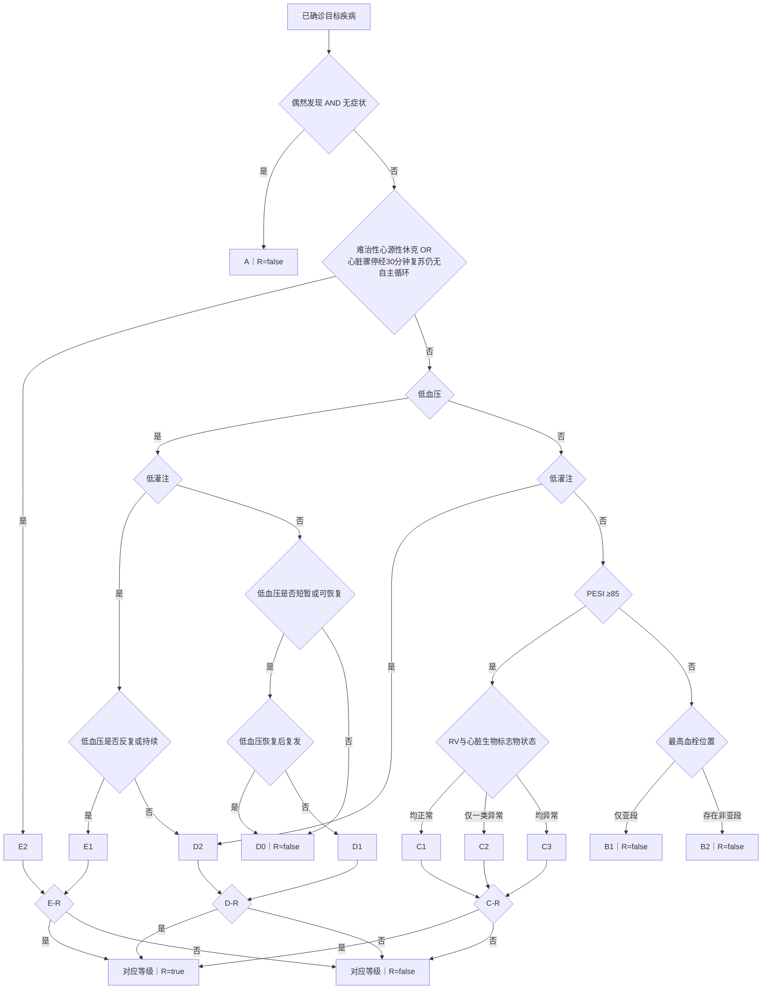

# 规则引擎规范


| 属性   | 内容                       |
| ---- | ------------------------ |
| 状态   | 当前实现                     |
| 规则版本 | 2.2.0                    |
| 输入   | 包含全部 35 个原始事实字段的 JSON 对象 |
| 输出   | 去重、稳定排序的 `results` 列表    |


本规范只定义分级公式、优先级、缺失值语义和输出契约。字段名、类型、单位、提取提示词和未提及时的默认值统一见[字段策略](字段策略.md)；运行时校验必须同时体现在 `src/medi/grading/models.py` 和 `src/medi/grading/parser.py`，不能只写在文档里。

## 1. 输入与缺失值

每个原始字段都必须有 `value`、`mentioned`、`evidence`。

已确定取值时，`mentioned=true` 且 `value` 类型正确，通常要求非空原文证据；字段注册表标明 `absence_false` 的布尔字段允许按提示词的“未记载即 false”约定使用 `value=false, mentioned=true, evidence=null`。其余未提及时，三个值必须分别为 `null`、`false`、`null`。

顶层拒绝缺失或未知字段，事实对象拒绝多余属性。

病历没提到某个字段时，先看它有没有设置默认值：有就按默认值计算；没有就分别考虑它可能满足、也可能不满足相关条件。病历明确给出的值始终优先，不能被默认值覆盖。

- 当前有 12 个布尔原始字段启用未提及时默认值 `false`，名单见[字段策略](字段策略.md)；这些字段不再按真假两种状态展开。未配置默认值的缺失字段仍按“考虑所有可能”处理。以后新增默认值时，必须同步修改程序和测试，不能只改字段表。

规则引擎最后只列出不同的 `(grade, has_r)` 结果，不列出每种缺失字段的组合。例如五项低灌注指标都没提到时，只需考虑“存在低灌注”和“不存在低灌注”，不用列出五项各自真假的 32 种排列。

一个字段在一次假设中要前后一致。比如血氧没提到，可以分别考虑“低于 90%”和“不低于 90%”：若假设低于 90%，PESI 和 C-R 都按低于 90% 计算，不能一处按低、一处按不低。精神状态和呼吸频率也是如此。

## 2. 主等级判定

以下为确定事实时的一条路径。缺失事实按第 1 节保留所有可达路径。

1. `A = incidental_finding AND asymptomatic`。A 成立即结束，和其余主等级互斥。
2. A 不成立时，`E2 = refractory_cardiogenic_shock OR no_rosc_after_30_minutes`。后一个字段表示“心脏骤停经 30 分钟复苏后仍未恢复自主循环”这一完整条件。E2 成立即结束。
3. 计算低血压 `H = systolic_bp_mmhg < 90 OR systolic_bp_drop_mmhg > 40 OR vasopressor_used OR fluid_treatment_given`。治疗事实按字段提示词提取；升压药和补液须是本次急性肺栓塞病程中的实际治疗，不把计划治疗算作已实施。
4. 用同一次测量的收缩压、舒张压计算 `MAP = (systolic_bp_mmhg + 2 × diastolic_bp_mmhg) / 3`，再计算 `L = lactate_mmol_l > 2 OR altered_mental_status OR MAP < 60 OR acute_kidney_dysfunction OR cold_clammy_extremities`。MAP 不由 LLM 单独提取。
5. `H=true, L=true`：若 `recurrent_or_persistent_hypotension=true`，为 E1；否则为 D2。`recurrent_or_persistent_hypotension` 是一个合并字段，表示“反复或持续”任一成立。
6. `H=true, L=false`：先用现有条件判断低血压是否短暂或已恢复；若两者均不成立，为 D0。若至少一项成立，先成为 D1 候选，再判断 `hypotension_recurred_after_recovery`：恢复后复发为 `true` 则改判 D0，为 `false` 则判 D1；该字段未提及且无默认值时，两级均可达。“短暂”指所有已命中的血压数值阈值对应持续时间均 `<15` 分钟；两项阈值均命中时，两项持续时间都须 `<15` 分钟。仅升压药或补液使 `H=true`、没有数值阈值命中时，现有时间字段不能证明“短暂”，但仍可依据现有“已恢复”条件进入 D1 候选。D0 固定 `has_r=false`。
7. `H=false, L=true`：为 D2。
8. `H=false, L=false`：计算 PESI；`PESI >= 85` 进入 C，`PESI < 85` 进入 B。

低血压、低灌注、PESI、主等级和 R 均由程序派生，LLM 不直接输出这些结论。已命中血压阈值的持续时间缺失、且无法由“已恢复”确定 D1 候选时，候选条件真假均可能；其中候选为真的路径还须接受复发排除。D1 候选已经成立但恢复后复发状态缺失时，D1/D0 两级均须保留。未命中阈值的持续时间不参与判断。`hypotension_recurred_after_recovery` 只用于此处 D1 候选的排除，不代替 E1/D2 分支使用的 `recurrent_or_persistent_hypotension`。

### 2.1 PESI

`PESI = 年龄 + 男性×10 + 癌症病史×30 + 心衰病史×10 + 慢性肺病×10 + (心率≥110)×20 + (systolic_bp_mmhg<100)×30 + (呼吸频率≥30)×20 + (体温<36°C)×20 + 精神状态改变×60 + (SpO₂<90%)×20`。

年龄按每岁 1 分，不取整；缺失时允许任意有限非负年龄，因此用上下界判断两侧是否可达。恰好 85 分进入 C，这是本项目自定义的 B/C 分流阈值。进入 PESI 的路径上 `L=false`，故共享的 `altered_mental_status` 必为 `false`，在该路径贡献 0 分。

### 2.2 B/C 子级


| 主等级 | 子级                                     |
| --- | -------------------------------------- |
| B   | 最高血栓位置仅亚段为 B1；存在非亚段血栓为 B2              |
| C   | RV 与心脏生物标志物均正常为 C1；仅一类异常为 C2；两类均异常为 C3 |


## 3. R 判定


| 等级         | `has_r=true` 的条件                                                     |
| ---------- | -------------------------------------------------------------------- |
| A、B1、B2、D0 | 永不成立                                                                 |
| C1、C2、C3   | `spo2_percent < 90 OR respiratory_rate_bpm >= 30 OR oxygen_required` |
| D1、D2      | `nasal_cannula_over_6_l_min OR face_mask_oxygen`                      |
| E1、E2      | `noninvasive_ventilation OR invasive_mechanical_ventilation`         |


R 条件缺失且不能被其他已知项确定时，同一等级可同时输出 `has_r=false` 与 `has_r=true`。

## 4. 判定流程图




## 5. 输出契约与验收

核心 `medi.grading.classify`、命令行和既有规则 API 的公开分级结果只包含：

```json
{"results":[{"grade":"C1","has_r":false},{"grade":"B1","has_r":false}]}
```

`grade` 只允许 A、E2、E1、D2、D1、D0、C1、C2、C3、B1、B2。结果按此顺序排序；同一等级先 `has_r=false`，再 `true`。这些既有接口不公开 PESI 分数、内部假设或推导路径。本地医生工作台另有解释用接口 `/api/decision-tree` 和 `/api/decision-trace`，只展示与输入事实相容的判断路径，不改变上述分级输出契约。

回归测试必须至少覆盖 A 互斥、E2 优先级、五项低灌注各自单独命中、治疗单独触发 D0、D1 的 14/15 分钟边界、双阈值一短一长、恢复后复发为真/假/缺失时的 D1/D0 分流、PESI 的 84/85/86 分边界、共享字段一致性、R 真假及全部字段缺失时的去重和运行时间。字段校验测试必须与运行时 Schema 同步。
