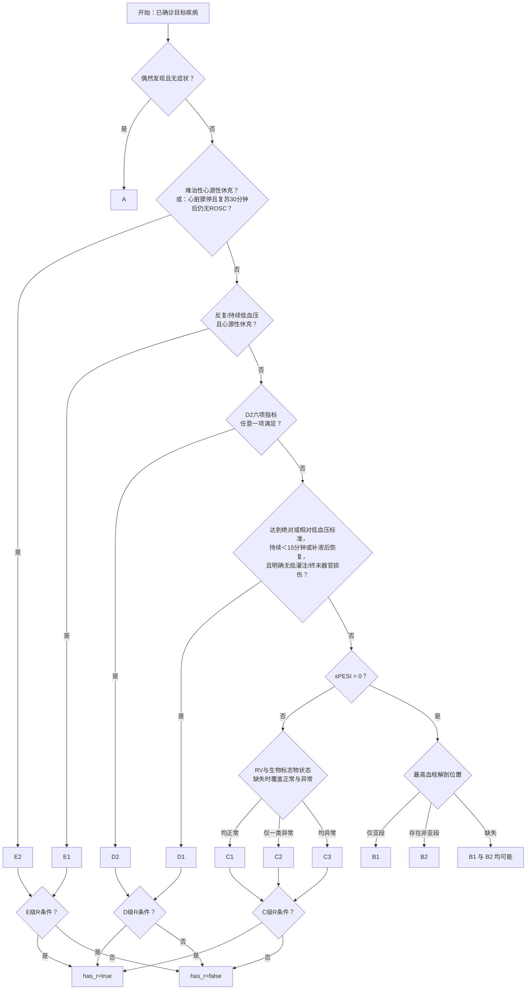

# A–E 分级规则引擎规范

## 1. 目的与边界

本规范定义一套确定性的 A–E 分级规则引擎。输入为 LLM 从已确诊目标疾病病历中提取的固定结构事实表，输出为该事实表在所有缺失值可能状态下能够产生的全部不同等级及呼吸分型 `R`。

LLM 负责阅读病历、提取事实、处理文本歧义，并在病历表述不一致时综合选择最终值。规则引擎假设 LLM 已按照约定结构正确提供数据，不再次解析病历文本，也不处理单位换算或病历冲突。

规则引擎不负责：

- 判断目标疾病是否确诊；
- 从自然语言病历中提取事实；
- 阅读或解释临床指南；
- 根据未记录信息进行推测；
- 判断或合并相互冲突的病历描述；
- 从证据文本中重新推导变量值；
- 计算规则之外的诊断或治疗建议。

规则引擎负责：

- 读取 LLM 已提取的结构化事实；
- 根据事实值完成阈值判断和派生变量计算；
- 按固定优先级执行分类规则；
- 输出最终等级及是否带 `R`。

规则版本仅指向规则引擎。指南及其版本由指南解释 Agent 独立管理。

## 2. 数据分层

### 2.1 `extracted`：LLM 提取层

LLM 必须输出规则引擎定义的全部变量。即使病历没有提到某个变量，也必须输出对应事实对象，使每次输入具有完全相同的结构。

LLM 应优先提取病历中的原始数值；无法用单一数值表达的临床概念可以提取为布尔值或枚举值。每个变量均使用统一事实结构。

病历明确提到：

```json
{
  "value": 92,
  "mentioned": true,
  "evidence": "入院收缩压92 mmHg"
}
```

病历未提到：

```json
{
  "value": null,
  "mentioned": false,
  "evidence": null
}
```

| 字段 | 类型 | 说明 |
|---|---|---|
| `value` | number、boolean、string 或 null | 提取值；未提及时为 `null` |
| `mentioned` | boolean | 病历是否明确提到该事实 |
| `evidence` | string 或 null | 支持该值的病历原文；未提及时为 `null` |

有效组合只有两种：

| `mentioned` | `value` | `evidence` | 含义 |
|---|---|---|---|
| `true` | 非 `null` | 非空字符串 | 变量可参与规则计算 |
| `false` | `null` | `null` | 变量按缺失处理 |

布尔变量的明确阴性必须表示为：

```json
{
  "value": false,
  "mentioned": true,
  "evidence": "既往无恶性肿瘤病史"
}
```

事实中不包含单位字段。数值变量的标准单位由变量名和第3节固定，LLM 输出前负责转换为指定单位。

证据暂定为单个字符串。规则引擎不读取或分析 `evidence`，该字段供后续指南解释 Agent 和审查 Agent 使用。病历描述存在矛盾时，由 LLM 综合判断并输出一个最终事实；规则引擎不设置冲突状态。

### 2.2 `derived`：规则加工层

派生变量不由 LLM 输出，而由规则引擎根据有效事实计算。派生层负责：

- 阈值比较；
- 原始变量的布尔化；
- sPESI 计分；
- 多个条件的 AND/OR 组合；
- 分类所需的中间状态。

### 2.3 `classification`：分类结果层

分类层按照第5节的顺序对每个可能状态执行分类，并将相同结果合并。公开输出为稳定排序的结果集合：

```json
{
  "results": [
    {"grade": "D2", "has_r": false},
    {"grade": "D2", "has_r": true}
  ]
}
```

- 每一项的 `grade`：不含 `R` 的一个可能等级；
- 每一项的 `has_r`：该可能等级是否带呼吸分型 `R`；
- 相同的 `(grade, has_r)` 只输出一次。

`grade="D2"` 且 `has_r=true`，展示时可组合为 `D2-R`。

## 3. 输入变量字典

所有下列变量都必须出现在 LLM 输出中，并使用第2.1节的事实结构。表中“由LLM判断”表示规则引擎直接使用布尔或枚举结果，不再分析其临床含义。

### 3.1 A/B/C及sPESI变量

| 变量名 | 类型 | 单位/允许值 | 定义与用途 |
|---|---|---|---|
| `incidental_finding` | boolean | true/false | 是否偶然发现；用于A级 |
| `asymptomatic` | boolean | true/false | 是否无症状；用于A级 |
| `age_years` | number | 岁 | 年龄；用于sPESI |
| `cancer_history` | boolean | true/false | 是否有癌症病史；由LLM判断 |
| `chronic_cardiopulmonary_disease` | boolean | true/false | 是否有慢性心肺疾病；由LLM判断 |
| `spesi_systolic_bp_mmhg` | number | mmHg | sPESI评估使用的收缩压，不与D1血压混用 |
| `heart_rate_bpm` | number | 次/分 | 心率；用于sPESI |
| `spo2_percent` | number | 0–100，% | 血氧饱和度；用于sPESI及C级R |
| `highest_thrombus_location` | enum | `subsegmental_only`、`non_subsegmental` | 最高血栓解剖位置；用于B1/B2 |
| `rv_abnormal` | boolean | true/false | 右心室是否异常；由LLM判断 |
| `cardiac_biomarker_abnormal` | boolean | true/false | 是否至少一种相关心脏生物标志物异常；由LLM判断 |

若亚段与非亚段血栓同时存在，`highest_thrombus_location` 输出 `non_subsegmental`。

### 3.2 D1变量

| 变量名 | 类型 | 单位/允许值 | 定义 |
|---|---|---|---|
| `hypotension_systolic_bp_mmhg` | number | mmHg | 本次低血压事件中用于D1判断的收缩压 |
| `sbp_below_90_duration_minutes` | number | 分钟 | SBP持续低于90 mmHg的时间 |
| `systolic_bp_drop_mmhg` | number | mmHg | 本次事件中SBP较原来血压的下降幅度；由LLM计算或判断 |
| `sbp_drop_gt_40_duration_minutes` | number | 分钟 | SBP较原来下降超过40 mmHg的持续时间 |
| `hypotension_resolved_after_fluid` | boolean | true/false | 达到低血压标准后，低血压是否在补液后恢复 |
| `hypoperfusion_or_end_organ_damage` | boolean | true/false | 是否存在低灌注或终末器官损伤；由LLM判断 |

仅记录“给予补液”不能视为 `hypotension_resolved_after_fluid=true`，必须有补液后血压恢复的事实。

### 3.3 D2变量

| 变量名 | 类型 | 单位/允许值 | 定义 |
|---|---|---|---|
| `lactate_mmol_l` | number | mmol/L | 乳酸 |
| `acute_kidney_dysfunction` | boolean | true/false | 是否存在急性肾功能不全；由LLM判断 |
| `urine_output_ml_kg_h` | number | mL/kg/h | 每公斤体重每小时尿量；不附加持续时间条件 |
| `altered_mental_status` | boolean | true/false | 是否存在精神状态改变；由LLM判断，规则引擎不分析病因 |
| `cardiac_index_l_min_m2` | number | L/min/m² | 心脏指数CI |
| `mean_arterial_pressure_mmhg` | number | mmHg | 平均动脉压MAP |

### 3.4 E级变量

| 变量名 | 类型 | 允许值 | 定义 |
|---|---|---|---|
| `recurrent_or_persistent_hypotension` | boolean | true/false | 是否存在反复或持续低血压；由LLM判断 |
| `cardiogenic_shock` | boolean | true/false | 是否存在心源性休克；由LLM判断 |
| `refractory_cardiogenic_shock` | boolean | true/false | 是否存在难治性心源性休克；由LLM判断 |
| `cardiac_arrest` | boolean | true/false | 是否发生心脏骤停；由LLM判断 |
| `no_rosc_after_30_minutes` | boolean | true/false | 心脏骤停复苏30分钟后是否仍未恢复自主循环；由LLM判断 |

### 3.5 呼吸分型变量

| 变量名 | 类型 | 单位/允许值 | 定义与用途 |
|---|---|---|---|
| `spo2_percent` | number | 0–100，% | 复用3.1中的变量；用于C级R |
| `respiratory_rate_bpm` | number | 次/分 | 呼吸频率；用于C级R |
| `oxygen_required` | boolean | true/false | 是否需要吸氧；由LLM判断，用于C级R |
| `nasal_cannula_flow_l_min` | number | L/min | 鼻导管吸氧流量；用于D级R |
| `face_mask_oxygen` | boolean | true/false | 是否使用面罩吸氧；用于D级R |
| `noninvasive_ventilation` | boolean | true/false | 是否使用无创机械通气；用于E级R |
| `invasive_mechanical_ventilation` | boolean | true/false | 是否使用有创机械通气；用于E级R |

## 4. 派生变量

`mentioned=true` 的事实使用确定值计算。`mentioned=false` 的事实覆盖其对应规则条件成立与不成立的所有可能状态。连续数值仅按规则阈值划分等价区间，不枚举区间内的具体数值。

### 4.1 sPESI

| 项目 | 阳性条件 | 分值 |
|---|---|---:|
| 年龄 | `age_years > 80` | 1 |
| 癌症病史 | `cancer_history = true` | 1 |
| 慢性心肺疾病 | `chronic_cardiopulmonary_disease = true` | 1 |
| 收缩压 | `spesi_systolic_bp_mmhg < 100` | 1 |
| 心率 | `heart_rate_bpm >= 110` | 1 |
| 血氧饱和度 | `spo2_percent < 90` | 1 |

已知项目按表计分。缺失项目同时覆盖阳性与阴性；分类只区分 `sPESI=0` 与 `sPESI>=1`，因此多个缺失项目直接压缩成这两种规则状态，不枚举所有计分排列。

### 4.2 D1

```text
absolute_hypotension_transient =
    hypotension_systolic_bp_mmhg < 90
    AND sbp_below_90_duration_minutes < 15
```

```text
relative_hypotension_transient =
    systolic_bp_drop_mmhg > 40
    AND sbp_drop_gt_40_duration_minutes < 15
```

```text
hypotension_threshold_met =
    hypotension_systolic_bp_mmhg < 90
    OR systolic_bp_drop_mmhg > 40
```

```text
fluid_recovery_path =
    hypotension_threshold_met
    AND hypotension_resolved_after_fluid = true
```

```text
D1 =
    (
        absolute_hypotension_transient
        OR relative_hypotension_transient
        OR fluid_recovery_path
    )
    AND hypoperfusion_or_end_organ_damage = false
```

持续时间恰好15分钟不满足短暂时间条件；若补液后恢复，仍可通过 `fluid_recovery_path` 命中D1。`hypoperfusion_or_end_organ_damage` 必须被明确提及且为 `false`，未提及不能视为“无低灌注”。

### 4.3 D2

```text
D2 =
    lactate_mmol_l > 2
    OR acute_kidney_dysfunction = true
    OR urine_output_ml_kg_h < 0.5
    OR altered_mental_status = true
    OR cardiac_index_l_min_m2 < 2.2
    OR mean_arterial_pressure_mmhg < 60
```

六项任意一项满足即命中。

### 4.4 E级

```text
E2 =
    refractory_cardiogenic_shock = true
    OR
    (
        cardiac_arrest = true
        AND no_rosc_after_30_minutes = true
    )
```

```text
E1 =
    recurrent_or_persistent_hypotension = true
    AND cardiogenic_shock = true
```

### 4.5 C级子级

RV或心脏生物标志物缺失时必须同时覆盖正常与异常。

| RV异常 | 生物标志物异常 | 输出 |
|---|---|---|
| false | false | C1 |
| true | false | C2 |
| false | true | C2 |
| true | true | C3 |

## 5. 分类优先级与主等级

分类按以下顺序检查，首次命中后停止主等级判断：

1. A
2. E2
3. E1
4. D2
5. D1
6. 根据sPESI进入B或C

A 与 E、D、C、B 类互斥。必须先判断 A；只有 A 不满足时才按 E→D→C→B 的展示顺序继续判断。C/B 仍由同一个 sPESI 分支决定，不改变判定逻辑。

### 5.1 A级

```text
A = incidental_finding = true AND asymptomatic = true
```

在一个确定状态中两项必须同时为真。任一项缺失时，分别保留其为真和为假的可能路径；任一项明确为假时，A不成立。

### 5.2 B级

未命中A、E、D且 `sPESI = 0` 时进入B级：

| `highest_thrombus_location` | 输出 |
|---|---|
| `subsegmental_only` | B1 |
| `non_subsegmental` | B2 |
| 未提及 | 同时输出B1与B2的可能路径 |

### 5.3 C级

未命中A、E、D且 `sPESI >= 1` 时进入C级，再按第4.5节输出C1、C2或C3。

## 6. 呼吸分型 `R`

呼吸分型在主等级确定后计算，不改变 `grade`。R变量缺失时同时覆盖满足与不满足；A、B1、B2固定 `has_r=false`。共享字段必须保持相关性，例如 SpO₂ 缺失且仅由其令sPESI阳性时，不得产生不带R的C级路径。

### 6.1 C级

适用于C1、C2、C3：

```text
has_r =
    spo2_percent < 90
    OR respiratory_rate_bpm >= 30
    OR oxygen_required = true
```

### 6.2 D级

适用于D1、D2：

```text
has_r =
    nasal_cannula_flow_l_min > 6
    OR face_mask_oxygen = true
```

面罩吸氧不要求最低流量；鼻导管恰好6 L/min不满足。

### 6.3 E级

适用于E1、E2：

```text
has_r =
    noninvasive_ventilation = true
    OR invasive_mechanical_ventilation = true
```

## 7. 分类树



## 8. 输出接口

```json
{"results": [{"grade": "D2", "has_r": false}, {"grade": "D2", "has_r": true}]}
```

- `grade`允许：`A`、`B1`、`B2`、`C1`、`C2`、`C3`、`D1`、`D2`、`E1`、`E2`；
- `has_r`仅表示是否带R；
- sPESI、派生条件、规则命中和证据不进入公开输出。

## 9. 缺失值处理

- 所有变量仍必须出现在输入中；未提及使用 `mentioned=false, value=null, evidence=null`；
- 每个缺失事实覆盖所有会改变规则结论的等价状态；
- 布尔值覆盖 `false/true`，枚举覆盖所有规则意义不同的分组，数值覆盖阈值两侧；
- 引擎穷尽的是不同最终输出，不是底层字段排列；
- OR规则直接压缩为 `{false, true}`。例如D2六项全部缺失时不会产生64种排列；
- AND规则同样只保留可区分的真假状态；
- 同一字段被多条规则复用时保持状态相关性；
- B级血栓位置缺失时输出B1和B2，不再输出泛化等级B；
- 规则引擎不处理病历冲突，由LLM输出最终值。

## 10. 验收测试

### 10.1 优先级

1. 同时满足A与任意E/D/B/C条件，只输出A。
2. A不满足且同时满足E1和E2，输出E2。
3. A不满足且同时满足E1和D2，输出E1。
4. A不满足且同时满足D1和D2，输出D2。

### 10.2 E级

5. 难治性心源性休克为true，输出E2。
6. 心脏骤停且复苏30分钟后仍无ROSC，输出E2。
7. 仅心脏骤停且30分钟后无ROSC缺失，同时保留E2成立与不成立路径。
8. 反复/持续低血压与心源性休克均为true，输出E1。

### 10.3 D级

9. 乳酸2.1 mmol/L，输出D2；乳酸2.0不因该项进入D2。
10. D2六项中任意一项满足即输出D2。
11. SBP 85 mmHg且低于90持续10分钟，明确无低灌注，输出D1。
12. SBP下降45 mmHg且下降超过40持续10分钟，明确无低灌注，输出D1。
13. SBP低于90持续20分钟但补液后恢复，明确无低灌注，输出D1。
14. 达到D1低血压条件但低灌注情况缺失，同时保留D1成立与不成立路径。
15. 达到D1低血压条件但存在低灌注，不输出D1。

### 10.4 A/B/C

16. 偶然发现与无症状必须同时为true才输出A。
17. 年龄缺失且其他条件确定阴性时，同时输出B路径和C路径。
18. sPESI=0且仅亚段血栓，输出B1。
19. sPESI=0且存在非亚段血栓，输出B2。
20. sPESI=0且血栓位置缺失，同时输出B1与B2。
21. sPESI≥1且RV、标志物均缺失，同时输出C1、C2、C3。
22. sPESI≥1且只有一类异常，输出C2。
23. sPESI≥1且两类均异常，输出C3。

### 10.5 R及边界

24. C级RR=30时 `has_r=true`；RR低于30且其他条件不满足时为false。
25. D级鼻导管6 L/min时不带R，6.1 L/min时带R。
26. D级使用面罩吸氧时带R，不要求流量。
27. E级使用任一无创或有创机械通气时带R。
28. A/B级即使R变量为true，也固定不带R。
29. 年龄80岁不计sPESI分，超过80岁计1分。
30. sPESI血压100 mmHg不计分，低于100计1分。
31. 心率110次/分计1分。
32. SpO₂ 90%不计分，低于90计1分。
33. D1持续时间恰好15分钟不满足短暂时间条件。
34. D2六项全部缺失时，D2仅产生真、假两个规则状态，不展开64种排列。
35. 全部字段缺失时，输出17个去重后的可能结果并在固定时间内完成。

## 11. 版本管理

- 当前规则版本：`2.0.0`；
- 阈值、变量定义、优先级、布尔组合或输出语义变化必须提升规则版本；
- 仅修正文案且不改变执行结果时提升补丁版本；
- 指南版本由指南解释 Agent 独立记录，不复用规则版本。
